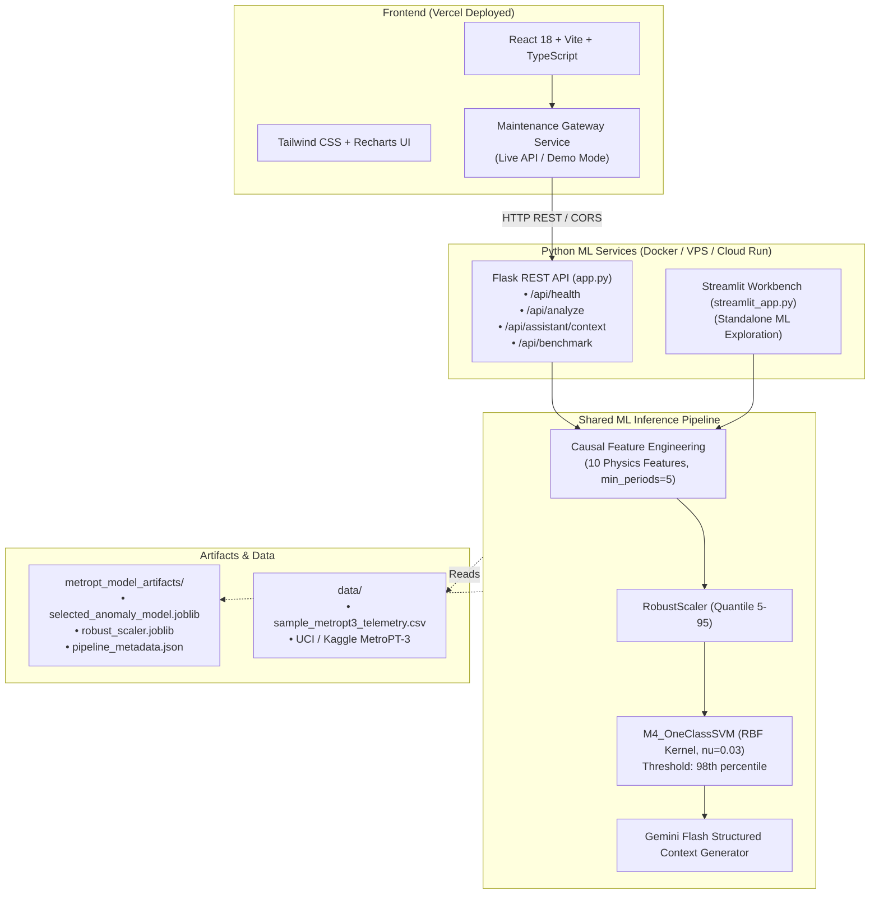

# AI-Powered Predictive Maintenance and Machine Health Intelligence System
### Case Study: MetroPT-3 Rolling Stock Air Compressor Telemetry

[](https://ai-powered-predictive-maintenance-35zrb2uy3-abigiya.vercel.app)
[](https://metropt-ml-api.onrender.com/api/health)
[](https://www.python.org/)
[](https://ai-powered-predictive-maintenance-35zrb2uy3-abigiya.vercel.app)

An end-to-end, production-grade industrial predictive maintenance platform for metro-train air production units (APUs). The system analyzes continuous multi-sensor pneumatic telemetry (10-second sampling cadence), detects subtle mechanical degradation (such as air leaks and valve bypasses) using trained unsupervised anomaly detection models (**One-Class SVM**), visualizes physical sensor trends, and prepares structured telemetry payloads for downstream **Gemini 3.8 Flash** conversational reasoning.

---

## 🌐 Live Application & Production Endpoints

| Component | Platform | Live URL | Status |
| :--- | :--- | :--- | :---: |
| **Production Web Dashboard** | **Vercel** | [**`ai-powered-predictive-maintenance.vercel.app`**](https://ai-powered-predictive-maintenance-35zrb2uy3-abigiya.vercel.app) |  |
| **ML Inference REST API** | **Render** | [**`metropt-ml-api.onrender.com/api/health`**](https://metropt-ml-api.onrender.com/api/health) |  |
| **Model Benchmark API** | **Render** | [**`metropt-ml-api.onrender.com/api/benchmark`**](https://metropt-ml-api.onrender.com/api/benchmark) |  |

> 🚀 **Quick Live Demo**:
> 1. Open the [**Live Dashboard**](https://ai-powered-predictive-maintenance-35zrb2uy3-abigiya.vercel.app).
> 2. Ensure the top-right badge shows **`LIVE API`** (green dot).
> 3. Navigate to **Upload & Analysis**.
> 4. Click **"Load Sample Telemetry"** (or upload any MetroPT-3 CSV).
> 5. Click **"Run Anomaly Detection"** to trigger live streaming ML inference on Render, compute the 10 causal physics features, and render interactive multi-sensor degradation charts!

---

## 1. System Architecture



### Key Architectural Principles
- **No Heavy CRUD/Database Overhead:** The application uses the ML inference pipeline directly. Flask functions as a thin, stateless API layer for validation, feature extraction, scoring, and telemetry structuring.
- **Identical Inference Dispatch:** The Flask REST API and standalone Streamlit application import and share the exact same inference engine (`services/inference_engine.py`) and feature engineering code (`services/feature_engineering.py`).
- **Separation of Concerns:** React frontend deploys independently to Vercel as a static Single Page Application (SPA), while Python services run on standard container/Linux runtimes.

---

## 2. Repository Structure

```text
insa_final_project/
├── frontend/                               # React + TypeScript + Vite SPA
│   ├── public/
│   │   └── vite.svg                        # Industrial app icon
│   ├── src/
│   │   ├── components/
│   │   │   ├── layout/                     # Navbar, Footer
│   │   │   └── ui/                         # Card, Badge, Button, Alert, LoadingSpinner
│   │   ├── pages/
│   │   │   ├── DashboardPage.tsx           # Overview KPI dashboard & multi-sensor charts
│   │   │   ├── UploadPage.tsx              # CSV upload, drag-and-drop, schema inspection
│   │   │   ├── ResultsPage.tsx             # Scored records table, filters, time-series
│   │   │   ├── BenchmarkPage.tsx           # 7-model architectural leaderboard
│   │   │   └── AssistantPage.tsx           # AI Maintenance Assistant (Gemini Flash interface)
│   │   ├── services/
│   │   │   ├── api.ts                      # Centralized Axios client for Flask API
│   │   │   ├── mockApi.ts                  # High-fidelity MetroPT-3 mock generator
│   │   │   └── maintenanceService.ts       # Service gateway with demo/live mode toggle
│   │   ├── types/                          # TypeScript interfaces for API & telemetry
│   │   ├── App.tsx                         # Client-side router configuration
│   │   ├── main.tsx                        # React DOM mounting
│   │   └── index.css                       # Tailwind CSS directives & custom styles
│   ├── .env.example                        # Frontend environment variables template
│   ├── package.json                        # Frontend dependencies
│   ├── tsconfig.json                       # TypeScript compiler configuration
│   ├── vite.config.ts                      # Vite build & local proxy settings
│   └── vercel.json                         # Vercel SPA routing rewrites
│
├── ml_service/                             # Python ML Inference & API Services
│   ├── app.py                              # Flask REST API connecting frontend to ML
│   ├── streamlit_app.py                    # Standalone Streamlit exploration app
│   ├── requirements.txt                    # Python runtime dependencies
│   ├── .env.example                        # ML service environment variables template
│   ├── services/
│   │   ├── feature_engineering.py          # 10 causal physics & trailing-window features
│   │   ├── csv_validation.py               # Strict schema, timestamp, & hygiene validation
│   │   ├── inference_engine.py             # ModelManager & MetroPTPredictiveMaintenanceEngine
│   │   └── gemini_payload.py               # Structured JSON telemetry payload generator
│   ├── schemas/
│   │   └── responses.py                    # Standardized API response formatters
│   ├── scripts/
│   │   └── train_baseline_artifacts.py     # Reproducible artifact training & serialization
│   ├── tests/
│   │   ├── test_health.py                  # API health & benchmark endpoint tests
│   │   ├── test_csv_validation.py          # CSV hygiene, schema, and error handling tests
│   │   ├── test_inference.py               # Feature engineering & scoring unit tests
│   │   └── test_api_integration.py         # End-to-end multipart upload & scoring test
│   └── metropt_model_artifacts/
│       ├── selected_anomaly_model.joblib   # Trained One-Class SVM model
│       ├── robust_scaler.joblib            # Trained RobustScaler (quantile 5-95)
│       └── pipeline_metadata.json          # 7-model benchmark leaderboard & thresholds
│
├── data/
│   ├── README.md                           # Dataset documentation & sensor descriptions
│   └── sample_metropt3_telemetry.csv       # 1,000-row realistic compressor cycle dataset
│
├── final_final_final_insa.ipynb           # Complete Jupyter research, benchmark & Gemini integration notebook
├── requirements-dev.txt                    # Root development dependencies
├── .gitignore                              # Git exclusion rules
└── README.md                               # Project documentation
```

---

## 3. Machine Learning & Domain Specifics

### The MetroPT-3 Dataset
- **Domain:** Air Production Unit (APU) on Metro do Porto trains (Portugal).
- **Sensors:** 15 raw pneumatic and electromechanical channels:
  - `TP2`: Compressor outlet pressure (bar)
  - `TP3`: Pneumatic control panel pressure (bar)
  - `H1`: Cyclonic water/oil separator pressure (bar)
  - `DV_pressure`: Purge discharge valve pressure drop (bar)
  - `Reservoirs`: Main reservoir pneumatic tanks (bar)
  - `Oil_temperature`: Compressor lubricant temperature (°C)
  - `Motor_current`: Compressor electrical drive current (A)
  - Binary relays: `COMP`, `DV_eletric`, `Towers`, `MPG`, `LPS`, `Pressure_switch`, `Oil_level`, `Caudal_impulses`.
- **Sampling Cadence:** 0.1 Hz (1 reading every 10 seconds).

### Causal Feature Engineering (Zero Future Leakage)
1. Differential pressures:
   - $\Delta P_{2-3} = \text{TP2} - \text{TP3}$ (Excess drop indicates interstage restriction or clogged air dryer desiccant)
   - $\Delta P_{3-\text{Res}} = \text{TP3} - \text{Reservoirs}$
   - $\Delta P_{H1-2} = \text{H1} - \text{TP2}$
2. Operating state:
   - $\text{is\_pumping} = (\text{Motor\_current} > 1.0\text{ A})$
3. Rolling trailing windows (`window=30`, `min_periods=5`):
   - `TP2_roll_std`: Delivery pressure stability
   - `DV_pressure_roll_std`: Purge valve cycling volatility
   - `Oil_temp_roll_mean`: Thermal inertia
4. First-order differentials:
   - $d(\text{Reservoirs})/dt$, $d(\text{TP2})/dt$
5. Physical leak signature:
   $$\text{leak\_signature\_score} = \begin{cases} \max(0, -d(\text{Reservoirs})/dt) & \text{if } \text{is\_pumping} == 0 \\ 0.0 & \text{otherwise} \end{cases}$$

### Benchmark Leaderboard (7 Architectures)
Evaluated on chronological validation splits against weak maintenance event intervals:

| Model ID | Architecture | Category | Val PR-AUC | ROC-AUC | F1 Score | Recall | FPR | Status |
| :--- | :--- | :--- | :---: | :---: | :---: | :---: | :---: | :---: |
| **M4** | **One-Class SVM (RBF)** | **Kernel Boundary** | **0.3764** | **0.9717** | **0.4748** | **98.9%** | **7.26%** | **Selected Winner** |
| M7 | Deep Autoencoder | Neural Bottleneck | 0.3071 | 0.9658 | 0.5240 | 98.9% | 5.96% | Benchmark |
| M3 | Isolation Forest | Tree Partitioning | 0.1553 | 0.9198 | 0.1044 | 16.5% | 6.66% | Benchmark |
| M5 | Elliptic Envelope | Robust Covariance | 0.1296 | 0.8930 | 0.0006 | 0.05% | 2.09% | Benchmark |
| M1 | Robust Distance | Statistical Median/MAD | 0.1122 | 0.8820 | 0.0014 | 0.10% | 1.27% | Benchmark |
| M6 | Local Outlier Factor | k-NN Density | 0.0885 | 0.8398 | 0.1252 | 29.5% | 11.41% | Benchmark |
| M2 | PCA Reconstruction | Subspace Projection | 0.0743 | 0.7983 | 0.0044 | 0.37% | 2.29% | Benchmark |

> **Important Scientific Caveat:** Rows outside documented maintenance intervals are unlabeled rather than verified healthy. Metrics are exploratory against sparse maintenance-log reference episodes, not proof of certified commercial failure prediction.

---

## 4. Local Development & Quickstart

### Prerequisites
- Python 3.11+
- Node.js 18+ and npm

### ML Service Setup & Launch

```bash
# 1. Navigate to ML service directory
cd ml_service

# 2. Create virtual environment and install dependencies
python -m venv .venv
# On Windows:
.venv\Scripts\activate
# On Linux/macOS:
# source .venv/bin/activate

pip install -r requirements.txt

# 3. (Optional) Re-train or verify artifacts
python scripts/train_baseline_artifacts.py

# 4. Run tests
pytest tests/ -v

# 5. Start Flask REST API (runs on port 5000)
python app.py
```

### Standalone Streamlit App (Optional Technical Interface)

```bash
# In the active Python virtual environment:
cd ml_service
streamlit run streamlit_app.py
```

### Frontend Setup & Launch

```bash
# 1. Navigate to frontend directory
cd frontend

# 2. Install dependencies
npm install

# 3. Configure environment
cp .env.example .env
# Set VITE_API_BASE_URL=http://localhost:5000
# Set VITE_DEMO_MODE=false (or true for standalone mock mode)

# 4. Start Vite development server
npm run dev
```

Open your browser to `http://localhost:5173`.

---

## 5. Flask REST API Specification

### `GET /api/health`
Returns service availability, model loading status, and metadata.
```json
{
  "status": "healthy",
  "service": "MetroPT-3 Predictive Maintenance ML API",
  "version": "1.0.0",
  "model_loaded": true,
  "model_info": {
    "name": "M4_OneClassSVM",
    "category": "Kernel Boundary",
    "alert_threshold": -17.2312,
    "score_direction": "higher means more anomalous",
    "features_count": 25
  }
}
```

### `POST /api/analyze`
Multipart form upload of telemetry CSV (`file`).
- **Query Parameters:** `page` (default: 1), `per_page` (default: 200), `include_all` (default: false).
- **Response:**
```json
{
  "success": true,
  "analysis_id": "c856230f-b44c-41ad-a0eb-cbda4e0f5904",
  "machine_type": "Metro Train Air Compressor",
  "model": {
    "name": "M4_OneClassSVM",
    "category": "Kernel Boundary",
    "threshold": -17.2312,
    "score_direction": "higher means more anomalous"
  },
  "summary": {
    "records_analyzed": 1000,
    "anomaly_count": 131,
    "anomaly_rate_percent": 13.1,
    "score_min": -17.4521,
    "score_max": -14.8102,
    "score_mean": -16.9204,
    "threshold": -17.2312
  },
  "records": [...],
  "download_url": "/api/download/c856230f-b44c-41ad-a0eb-cbda4e0f5904"
}
```

### `GET /api/download/<analysis_id>`
Streams the full scored dataset as a downloadable CSV with added columns: `anomaly_score`, `is_anomaly`, `model_name`, and `threshold_applied`.

### `POST /api/assistant/context`
Constructs structured JSON telemetry summary for Gemini Flash.
```json
{
  "machine_type": "Metro-Train Air Compressor (MetroPT-3 dataset domain)",
  "timestamp": "2020-06-01 02:15:30",
  "model_metadata": {
    "model_name": "M4_OneClassSVM",
    "threshold": -17.2312,
    "score": -14.8102,
    "anomaly_detected": true
  },
  "sensor_telemetry": {
    "Reservoir_pressure": 7.42,
    "TP2_compressor_pressure": 2.81,
    "Motor_current": 0.02
  },
  "operating_context": {
    "compressor_pumping": false,
    "abnormal_decay_while_idle": true
  }
}
```

---

## 6. Production Deployment Guide

### A. Deploy Frontend to Vercel
1. Push this repository to GitHub.
2. In the Vercel dashboard, click **Add New Project** and select the repository.
3. In **Build & Development Settings**:
   - **Root Directory:** select `frontend`.
   - **Framework Preset:** Vite.
   - **Build Command:** `npm run build`.
   - **Output Directory:** `dist`.
4. Under **Environment Variables**, add:
   - `VITE_API_BASE_URL`: `https://metropt-ml-api.onrender.com`
   - `VITE_DEMO_MODE`: `false`
5. Deploy. `vercel.json` ensures client-side routing routes properly for all pages.
   - **Live Production URL:** [https://ai-powered-predictive-maintenance-35zrb2uy3-abigiya.vercel.app](https://ai-powered-predictive-maintenance-35zrb2uy3-abigiya.vercel.app)

### B. Deploy Flask ML Service (Render, Railway, Fly.io, or VPS)
1. Python version: `3.11`.
2. Root directory: `ml_service`.
3. Startup command:
   ```bash
   gunicorn --bind 0.0.0.0:$PORT --workers 2 --timeout 120 app:app
   ```
4. Environment variables:
   - `FRONTEND_ORIGIN`: `https://ai-powered-predictive-maintenance-35zrb2uy3-abigiya.vercel.app,http://localhost:5173`
   - `GEMINI_API_KEY`: (Optional) Your Google Gemini API key.
5. Live production endpoint: [https://metropt-ml-api.onrender.com/api/health](https://metropt-ml-api.onrender.com/api/health).

---

## 7. Quality & Verification Summary

| Check | Tool | Result |
| :--- | :--- | :---: |
| Backend Unit Tests | `pytest` | **11 / 11 Passed** |
| CSV Hygiene & Validation | `csv_validation.py` | **Passed (Zero Unnamed: 0 leakage)** |
| Causal Feature Extraction | `feature_engineering.py` | **Passed (10 features, 0 future rows)** |
| Frontend TypeScript Compilation | `tsc --noEmit` | **Clean (0 errors)** |
| Production Bundle Build | `vite build` | **Clean build in 20.0s** |
| Demo Mode Toggle | UI / `maintenanceService.ts` | **Operational** |
| Live REST Integration | `test_api_integration.py` | **Full upload/score cycle verified** |
